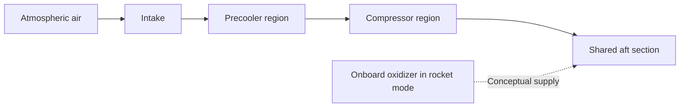

# QuinV | Vega concept demonstrator

Vega is QuinV’s study of a propulsion architecture with two conceptual modes. The air-breathing mode takes in atmospheric air through a precooler and compressor. The rocket mode would use onboard oxidizer with the atmospheric intake isolated. The first physical demonstrator is a 120 × 60 mm split-body model for inspecting the layout and testing room-temperature airflow on a bench.

## Architecture and physical model

The solid arrows show the order of stages represented in the air-breathing layout. The dotted arrow identifies the second mode at the concept level.

| Element | What investors can inspect |
| --- | --- |
| Intake and centrebody | The annular entry and how the incoming air is distributed around the centrebody. |
| Precooler region | An enlarged solid tube bundle that shows how a heat-exchanger stage occupies the flow path. |
| Compressor region | Fixed vanes that mark the compressor stage in the air-breathing architecture. |
| Core and bypass | The arrangement of the central passage and surrounding bypass in the open half. |
| Two-mode concept | An accompanying diagram showing the two conceptual supply paths. The printed model demonstrates the atmospheric path with room-temperature air. |

Vega uses computational geometry to generate its own shape from the architecture. The workbench compares nine tube-bundle candidates using assumed exchange area, tube clearance and a material proxy. Changing the assumed airflow case changes the intake and bundle geometry. The viewer displays the exported mesh alongside the selected candidate and the geometry checks.

## Bench demonstration

1. Open the workbench and show the split model, the two-mode concept and the candidate comparison for the displayed run.
2. Show the physical print open so the audience can follow the intake, tube bundle, fixed vanes and bypass. Assemble the two halves for the airflow test.
3. With an unsealed desk fan and an anemometer, take three readings with the print absent and three with it in place. Keep the fan setting and probe position fixed. Record the print run, setup and raw readings alongside the mean change reported by Vega.
4. Report the observed fit, passage accessibility and local air-speed change. If a test has not been run, present the mesh and the planned procedure and mark the results as pending.

## Evidence at this stage

The software can check mesh integrity and build-envelope fit. The bench test is intended to establish physical fit and repeatable local airflow observations. The precooler and compressor are static representations. Cooling effectiveness, compression, thrust and mode switching require separate evidence and carry no performance claims in this demonstration. QuinV plans to review the bench evidence before defining a dedicated aircraft.
